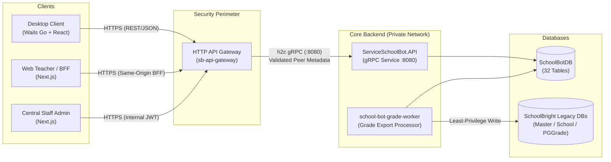

# SchoolBot v1.0 — คู่มือการเชื่อมต่อ API (API Integration Guide)

> เอกสารชุดส่งมอบโครงการ (Handover Package) · SchoolBot Target: `target/school-bot/` · Version: v1.0.0  
> วันที่ตรวจรับ: 2026-11-05 · สถานะ: ผ่านการตรวจรับความพร้อม (Verified & Release Ready)

---

## 1. ภาพรวมสถาปัตยกรรม API (API Architecture Topology)

SchoolBot ใช้สถาปัตยกรรม **Gateway-gRPC Microservices**:



> [!IMPORTANT]
> **Technical Invariants & Security Boundaries:**
> 1. Clients ภายนอกไม่มีสิทธิ์เรียกตรงมายัง `ServiceSchoolBot.API` (gRPC :8080) ทุกคำขอต้องผ่าน `sb-api-gateway` เท่านั้น
> 2. `sb-api-gateway` ทำหน้าที่พิสูจน์ตัวตน (Authenticate) ถอดรหัส JWT/Session จากนั้นแปลงเป็น gRPC Call พร้อมแนบ Trusted Caller Metadata
> 3. `ServiceSchoolBot.API` ใช้ `SchoolBotGrpcRunner` ตรวจสอบความถูกต้องของ Caller Header (`x-caller: api-gateway`), Request ID, สิทธิ์โรงเรียน (Multi-tenancy isolation), และปฏิเสธ Header ที่แปลกปลอม

---

## 2. มาตรฐาน Metadata และ HTTP-to-gRPC Mapping

### 2.1 Header มาตรฐานที่ Gateway ต้องส่งต่อให้ gRPC Service

| Header | ชนิดข้อมูล | คำอธิบายและข้อบังคับ |
|---|---|---|
| `x-caller` | string | **ต้องมีค่าเป็น `"api-gateway"` เสมอ** หากเป็นค่าอื่นระบบจะปฏิเสธคำขอทันที |
| `x-request-id` | string (UUID v4) | รหัสอ้างอิงคำขอ (36 ตัวอักษร) ใช้สำหรับ Distributed Tracing ตลอดกระบวนการ |
| `x-school-id` | integer | รหัสโรงเรียนสำหรับ Multi-tenant Isolation บังคับใช้ในทุกคำขอระดับโรงเรียน |
| `x-user-id` | integer | รหัสผู้ใช้งาน (Student, Teacher, หรือ Staff Admin) |
| `x-user-type` | string | ประเภทผู้ใช้: `"student"`, `"teacher"`, หรือ `"staff_admin"` |
| `x-is-admin` | string (`"true"`/`"false"`) | ระบุว่าผู้ใช้มีสิทธิ์ระดับ Admin โรงเรียนหรือไม่ |
| `x-employee-id` | integer (optional) | รหัสบุคลากรครู (สำหรับผู้ใช้ประเภทครู) |
| `x-device-entitlement` | string (JWT) | โทเคนยืนยันสิทธิ์เครื่อง Desktop ที่ผ่านการ Activate กับ License ของโรงเรียน |

> [!WARNING]
> Headers ต่อไปนี้จะถูกระบบบล็อกและปฏิเสธหากตรวจพบ เพื่อป้องกัน Credential Leakage:  
> `cookie`, `authorization`, `x-forwarded-for`, `jabjai-*`, `x-tenant-id`, `x-account-id`, `x-profile-id`, `x-principal`, `x-role`, `x-identity`

---

## 3. สรุปบริการ gRPC (Service Contracts)

ไฟล์ Protocol Buffers ต้นทางอยู่ที่ `web/src/ServiceSchoolBot.Infrastructure/Protos/ServiceSchoolBot/`:

### 3.1 LicenseService (`License.proto`)
จัดการ License Key, การ Activate ผูกเครื่อง, และการตรวจสิทธิ์:
- `ListLicenses`: เรียกดูรายการ License ของโรงเรียน
- `CreateLicense`: ออก License Key ใหม่สำหรับโรงเรียน
- `ActivateLicense`: ผูกเครื่อง Desktop กับ License Key (ยืนยัน Public Key ของเครื่อง และออก Entitlement JWT อายุ 15 นาที หรือตามอายุ License)
- `RevokeLicense`: ยกเลิก License ทันที

### 3.2 ProjectService (`Project.proto`)
จัดการการบันทึก โหลด คัดลอก และจัดการโครงงานของผู้เรียนบนคลาวด์:
- `CreateProject`: บันทึกโครงงานใหม่ พร้อมสร้าง Revision 1 อัตโนมัติใน Transaction เดียว (มติ 051)
- `GetProject`: ดึงข้อมูลโครงงานและเนื้อหาบล็อก/โค้ด/ท่าทางหุ่นยนต์
- `UpdateProject`: อัปเดตโครงงานและบันทึก Revision ใหม่ (รองรับ Optimistic Concurrency ผ่าน `IfMatch` ETag)
- `CopyProject`: คัดลอกโครงงานไปยังอีกโหมดหรือเป็นโครงงานใหม่
- `DeleteProject`: ลบโครงงาน (Soft Delete พร้อมบันทึกประวัติ)
- `ListProjects`: แสดงรายการโครงงานของผู้เรียน แยกตามโหมด (`coding-adventure`, `block-programming`, `robot-control`)

### 3.3 CurriculumService (`Curriculum.proto`)
จัดการหลักสูตร แบบเรียน และการนำเข้าเนื้อหาจากภายนอก:
- `GetCurriculum`: ดึงโครงสร้างหลักสูตรและลำดับบทเรียน
- `ImportCurriculumRevision`: นำเข้าข้อมูลหลักสูตรจาก Google Sheet พร้อมบันทึก Version และ `ImportSource` (migration-002)
- `PublishCurriculumRevision`: ประกาศใช้งานหลักสูตรเวอร์ชันใหม่
- `ListActivities`: ดึงรายการกิจกรรม การทดลอง และข้อสอบประจำหลักสูตร

### 3.4 AssessmentService (`Assessment.proto`)
ระบบการสอบ การตรวจอัตโนมัติ และการประเมินผล:
- `StartAttempt`: เริ่มทำข้อสอบ (บันทึก Attempt Snapshot, สุ่มข้อสอบ, กำหนดเวลา Deadline ห้ามเริ่มซ้ำหากมีข้อสอบเดิมค้างอยู่)
- `SaveAttemptAnswers`: บันทึกคำตอบระหว่างทำข้อสอบ (Idempotent)
- `SubmitAttempt`: ส่งข้อสอบและคำนวณคะแนนอัตโนมัติ (Finalize Grade)
- `GrantRetake`: ครูให้อนุญาตทำข้อสอบใหม่สำหรับนักเรียนรายคน
- `UpdateActivityPolicy`: ครูปรับปรุงเกณฑ์การสอบ เวลาเปิด-ปิด และระยะเวลา
- `SetScoringPolicy`: กำหนดสูตรการคำนวณคะแนนรวมและเกณฑ์การผ่าน
- `SetGradeMapping`: ผูกช่องคะแนน SchoolBot เข้ากับ GradeSlot ของโรงเรียน
- `CreateScorePreview`: แสดงภาพตัวอย่างคะแนนก่อนส่งออกจริง พร้อมตรวจจับคะแนนชน (Conflict Detection)
- `ConfirmScoreExport`: ยืนยันการส่งออกคะแนนเข้าสู่ Outbox Queue สำหรับ Worker
- `ProcessScoreExport`: รัน Worker ประมวลผลส่งออกคะแนนไปยังฐานข้อมูลคะแนนเดิมด้วย Compare-And-Swap (CAS)

### 3.5 ReleaseService (`Release.proto`)
บริการตรวจสอบการอัปเดตและรายการติดตั้ง:
- `GetLatestRelease`: ตรวจสอบเวอร์ชันล่าสุดของ SchoolBot ตาม Channel (Stable/Beta)
- `GetReleaseManifest`: ดึง Release Manifest ที่มี SHA-256 Hashes และ Signature เพื่อให้ Desktop Client ตรวจสอบความถูกต้องก่อนอัปเดต

---

## 4. มาตรฐานการจัดการข้อผิดพลาด (Error Handling & Trailers)

เมื่อเกิดข้อผิดพลาด gRPC จะคืนค่าตาม RFC มาตรฐาน พร้อม Trailers พิเศษ 2 รายการสำหรับ Client และ Gateway:

```text
grpc-status: <StatusCode>
grpc-message: <ErrorMessage>
sb-error-bin: <Serialized Protobuf ErrorDetail>
schoolbot-error-bin: <Serialized Protobuf SchoolBotError>
```

### รายการ Error Codes สำคัญ

| Code | HTTP Status | gRPC Status | คำอธิบาย |
|---|---|---|---|
| `NOT_FOUND` | 404 | `NotFound` | ไม่พบข้อมูลที่ระบุ |
| `INVALID_INPUT` | 400 | `InvalidArgument` | พารามิเตอร์หรือข้อมูลไม่ถูกต้องตาม Schema |
| `VERSION_CONFLICT` | 412 | `FailedPrecondition` | ข้อมูลถูกแก้ไขโดยผู้อื่นไปก่อนหน้า (ETag Mismatch) |
| `ATTEMPT_EXPIRED` | 409 | `Aborted` | หมดเวลาการทำข้อสอบแล้ว |
| `LICENSE_REQUIRED` | 403 | `PermissionDenied` | เครื่องยังไม่ได้เปิดใช้งาน License หรือ License หมดอายุ |
| `INTERNAL_ERROR` | 500 | `Internal` | ระบบเกิดข้อผิดพลาดภายใน (ไม่รั่วไหล Exception Stack Trace ออกไป) |

---

## 5. การทดสอบการเชื่อมต่อ API (Testing & Verification)

สามารถใช้เครื่องมือ gRPC Client เช่น `grpcurl` หรือ Integration Tests ตรวจสอบได้โดยตรง:

```bash
# ตรวจสอบ Health Endpoint (HTTP)
curl -v http://localhost:8081/healthz

# ตรวจสอบ gRPC Services ผ่าน grpcurl (ตัวอย่างบน Local Dev)
grpcurl -plaintext -H "x-caller: api-gateway" -H "x-request-id: 11111111-1111-1111-1111-111111111111" \
  localhost:8080 list
```
