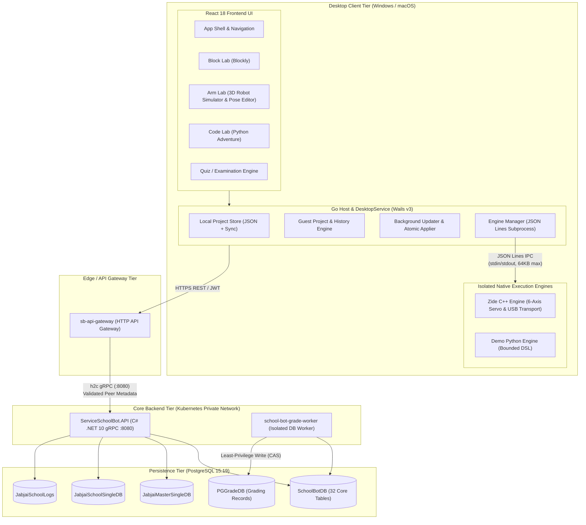

# SchoolBot — System Architecture Documentation

> Release: SchoolBot v1.0 (Phase 7 Final Handover Package)  
> Workspace: `target/school-bot/` · Date: 2026-11-05 · Status: Verified

---

## 1. High-Level Architecture Overview

SchoolBot is a hybrid desktop and cloud learning platform designed for coding education and physical robotic arm manipulation across primary and secondary schools.

---

## 2. Desktop Client Architecture

### 2.1 Separation of Concerns
1. **Frontend UI Layer (`app/frontend/`)**:
   - Built on React 18 with TypeScript and Vite.
   - Decoupled from native OS specifics; calls the host purely via `core/client.ts` typed methods.
   - Multi-language localization (i18n) supporting Thai, English, and Chinese with interpolation safeguards.
   - Three independent workspace modes:
     - **Block Lab**: Blockly visual block-based programming with structured repeat bounds.
     - **Arm Lab**: 3D kinematics visualization, 6-axis joint slider calibration, trajectory sequence playback, and physical USB controller.
     - **Code Lab**: Python coding adventure using bounded syntax evaluation.
     - **Examination**: Timed test attempts, randomized question pools, and auto-submission.

2. **Go Desktop Host (`app/`)**:
   - Thin Wails v3 adapter (`DesktopService`) exposing minimal API bindings to JavaScript.
   - **Engine Manager (`app/internal/engine/`)**: Spawns isolated native processes on demand. Never allows arbitrary shell execution or untrusted path lookups. Enforces 64 KB input ceiling, 1 MB output limit, and a strict 5-second deadline per IPC invocation.
   - **Local Storage (`app/internal/project/`)**: Atomic file writes (`.tmp` + sync + rename) into `%APPDATA%\SchoolBotPoC` (Windows) or `~/Library/Application Support/SchoolBotPoC` (macOS). Ensures no local learning progress is lost during network disruption.
   - **Updater Applier (`app/internal/updater/`)**: Background updater with publisher certificate pin verification, atomic binary swap, and rollback recovery.

3. **Native Execution Engines (`engines/`)**:
   - **Zide C++ Engine (`engines/zide/`)**:
     - Standalone high-performance C++17 engine compiled via Zig 0.15.2 / Clang.
     - Communicates with hardware via HID (`hidapi`) and CDC Serial transport on Windows (`setupapi`) and macOS (`IOKit`).
     - Real-time safety guards: motion bounding, 6-axis velocity/PWM profiling, emergency disconnect torque cutoff (`$DST!`), and dry-run simulation mode.
   - **Demo Engine (`app/cmd/demo-engine/`)**:
     - Lightweight Go-based DSL interpreter for classroom block and python adventure execution.

---

## 3. Backend & gRPC Microservices Architecture

### 3.1 Layered Design (`web/src/`)
- **Domain Layer (`ServiceSchoolBot.Domain`)**: Pure business logic, immutable domain records, invariants, and validation rules. No database or web dependencies.
- **Application Layer (`ServiceSchoolBot.Application`)**: Use cases, DTOs, repository interfaces (`ISchoolBotRepositoryScope`), and domain service orchestrators (`AssessmentReadService`, `LearningSubmissionService`, `ScoreExportService`, `QuestionBankService`, `LevelPromotionService`).
- **Infrastructure Layer (`ServiceSchoolBot.Infrastructure`)**: EF Core PostgreSQL repository implementations (`SchoolBotDbContext`, `SchoolBotUnitOfWork`), memory cache, Protobuf serialization, and external system adapters.
- **API Composition Root (`ServiceSchoolBot.API`)**: ASP.NET Core .NET 10 host exposing gRPC services, HTTP health probe (`:8081/healthz`), peer authentication filter (`SchoolBotGrpcRunner`), and background task scheduler (`LearningWorker`).

### 3.2 Concurrency & Idempotency Controls
- **Optimistic Concurrency**: Tracked via `UpdateDate` mapped to opaque HTTP ETag tokens (`OpaqueConcurrencyToken.ToETag`). Stale edits receive `VERSION_CONFLICT` (HTTP 412 / gRPC FailedPrecondition).
- **Idempotent Mutations**: All mutating calls (`StartAttempt`, `SaveAttemptAnswers`, `SetGradeMapping`, `ConfirmScoreExport`) require an `x-idempotency-key` (UUID v4) deduplicated at the database layer via `SchoolBotIdempotency` table.
- **Transactional Consistency (Decision 051)**: Project creation and revision 1 generation occur in a single atomic database transaction.

### 3.3 Grade Export & Process Isolation (SEC-001-002)
- To prevent potential lateral movement or unintended writes to the production grading database (`PGGradeDB`), `ServiceSchoolBot.API` does not have write access to `PGGradeDB`.
- Scores ready for export are saved into an internal `SchoolBotScoreOutbox` queue in `SchoolBotDB`.
- An isolated background worker deployment (`school-bot-grade-worker`) processes outbox items using Compare-And-Swap (CAS) locking, validates teacher authorization, and issues durable receipts upon successful sync.

---

## 4. Database Architecture & Schema

### 4.1 Schema Distribution
- **SchoolBotDB (PostgreSQL 15.19)**: 32 tables with 450 fields covering:
  - Licenses & Bindings: `SchoolBotLicense`, `SchoolBotLicenseBinding`
  - Sessions & Projects: `SchoolBotSession`, `SchoolBotProject`, `SchoolBotProjectRevision`
  - Curriculum & Activities: `SchoolBotCurriculum`, `SchoolBotLesson`, `SchoolBotActivity`, `SchoolBotCriterion`
  - Question Banks & Quizzes: `SchoolBotQuestionBank`, `SchoolBotScoringPolicy`
  - Assessment Attempts: `SchoolBotAttempt`, `SchoolBotAssessment`, `SchoolBotSubmission`, `SchoolBotRetakeGrant`
  - Level Promotion: `SchoolBotLevel`, `SchoolBotLevelProposal`, `SchoolBotLevelPromotionPolicy`
  - Grade Sync & Outbox: `SchoolBotGradeSlot`, `SchoolBotScoreMapping`, `SchoolBotScorePreview`, `SchoolBotScoreOutbox`, `SchoolBotScoreExport`
  - Audit & Idempotency: `SchoolBotAuditEvent`, `SchoolBotIdempotency`, `SchoolBotStaffRole`, `SchoolBotRelease`

---

## 5. Security & Trust Architecture

| Vector | Control & Implementation |
|---|---|
| **Transport Security** | TLS 1.3 enforced at Gateway perimeter; private h2c gRPC within cluster network |
| **Peer Trust Validation** | `SchoolBotGrpcRunner` verifies `x-caller: api-gateway` and rejects direct external callers |
| **Tenant Isolation** | Strict `SchoolId` scoping on all queries; cross-school access strictly forbidden |
| **Device Licensing** | Cryptographically signed device proof (ECDSA P-256) bound to hardware JKT |
| **Process Isolation** | `PGGRADE_DB_CONNECTION_STRING` isolated solely to the grade worker container |
| **Engine Safety Limits** | 64 KB input cap, 1 MB stdout limit, non-shell execution, and physical stop timeouts |
| **Clean Packaging** | Production installers built without debug symbols, map files, or secrets (`.key`, `.pem`, `.pfx`) |
